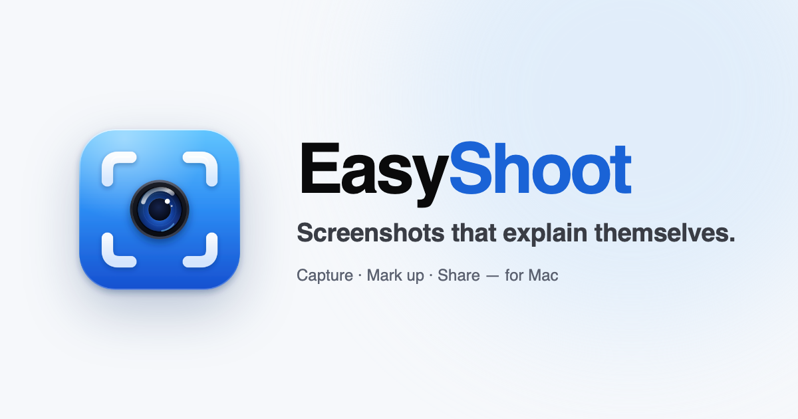

<div align="center">


# EasyShoot website

**Screenshots that explain themselves.** The landing page for EasyShoot, a screenshot app for Mac.

[easyshoot.haythamasalama.me](https://easyshoot.haythamasalama.me) · [العربية](https://easyshoot.haythamasalama.me/ar/) · [Français](https://easyshoot.haythamasalama.me/fr/) · [Español](https://easyshoot.haythamasalama.me/es/) · [Deutsch](https://easyshoot.haythamasalama.me/de/)




</div>

## What's here

| | |
|:--|:--|
| **Pages** | The landing page once per language (`/`, `/ar/`, `/fr/`, `/es/`, `/de/`), a user guide (`/docs/`, one page per topic), a changelog (`/changelog/`), a press kit (`/press/`) and an HTML sitemap (`/sitemap/`) in every language, plus `privacy.html` and `support.html` in English and Arabic (`/ar/…`), built from `src/i18n/legal.ts` |
| **Guides and comparisons** | Four how-to guides (`/guides/…`) and five honest comparisons (`/compare/…`: CleanShot X, Shottr, Snagit, Lightshot, macOS Screenshot), each in all five languages |
| **Look** | Liquid Glass surfaces, separate light and dark colour sets, one blue accent. See [BRAND.md](BRAND.md) |
| **Pictures** | The editor is drawn in HTML in the page's language, so it stays sharp and follows the theme |
| **Motion** | [Motion](https://motion.dev): hero entrance, scroll reveals, press springs, a circular theme switch. Off for reduced motion |
| **Search** | Per-language titles, `hreflang`, Open Graph, JSON-LD (app, page, FAQ), a sitemap with language alternates and `llms.txt` for AI search |

> App Store Connect links to `privacy.html` and `support.html`, so those two paths must never change.

## Quick start

```bash
npm install
```

```bash
npm run dev
```

Opens at <http://localhost:4321>. To check the production output:

```bash
npm run build && npm run preview
```

## Project map

```text
src/
  pages/            one folder per page, [lang]/ for ar, fr, es, de; privacy.astro and support.astro build to .html (build.format "preserve")
  layouts/Base.astro    <head>: SEO tags, hreflang, JSON-LD, theme before first paint
  components/Home.astro the landing page
  i18n/data.json        every string in all five languages
  i18n/index.ts         languages, paths, APP_STORE_URL
  lib/editor.ts         the drawn EasyShoot editor
  scripts/site.ts       theme, tabs, menus and Motion animations
  styles/global.css     colour tokens, Liquid Glass and layout
public/             icon, favicon, share image, wallpapers, robots.txt, llms.txt, privacy and support pages
BRAND.md            colours, logo, type, glass, motion and voice
```

## Everyday changes

| To change | Edit |
|:--|:--|
| Any text, in any language | `src/i18n/data.json` (`ui` for the page, `ed` for the drawn editor, `tabs` for the showcase) |
| The App Store link, once the app is live | `APP_STORE_URL` in `src/i18n/index.ts`. Buttons then open the App Store and "Coming soon" labels switch to download text |
| Colours or glass | The tokens at the end of `src/styles/global.css`, and the tables in [BRAND.md](BRAND.md) |
| The icon | `public/art/icon.svg`, then render `public/icon.png` at 1024 px with a transparent background |
| A guide or comparison | `src/i18n/articles/<lang>.json` (same keys in every language); the order is in `src/i18n/articles.ts`. Re-check competitor facts on their official sites before changing them |
| The user guide | Each topic is an entry in `src/i18n/docs/<lang>.json` (`title`, `short`, `description`, `intro` and `blocks`; a block can show the drawn editor with `art`: `mark`, `shape`, `pixel`, `ar` or `bg`). Add its slug to `DOC_GROUPS` in `src/i18n/docs.ts` to place it in the sidebar. A topic missing in a language shows the English text |
| The changelog, for each new version | Add a release at the top of `releases` in `src/i18n/changelog.json`: `version`, `date` (`YYYY-MM-DD`; leave it empty to show "Coming soon"), optional `major`, and `notes` per language with an `intro` and either `items` (plain lines, for fixes) or `groups` of `[emoji, title, text]` features. A missing language falls back to English |
| The privacy policy or support page | `src/i18n/legal.ts` (English and Arabic). Change the date when the policy changes |
| What AI search reads | `public/llms.txt` |

## Deploy

`.github/workflows/deploy.yml` builds the site on every push to `main`, publishes `dist/` to GitHub Pages, then tells IndexNow engines (Bing, Yandex and others) about every page in the sitemap. In **Settings → Pages**, set the source to **GitHub Actions**. `public/CNAME` keeps the custom domain.

---

<div align="center"><sub>The app's source lives in a separate, private repository.</sub></div>
